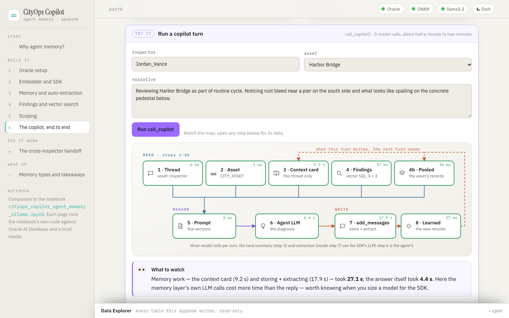
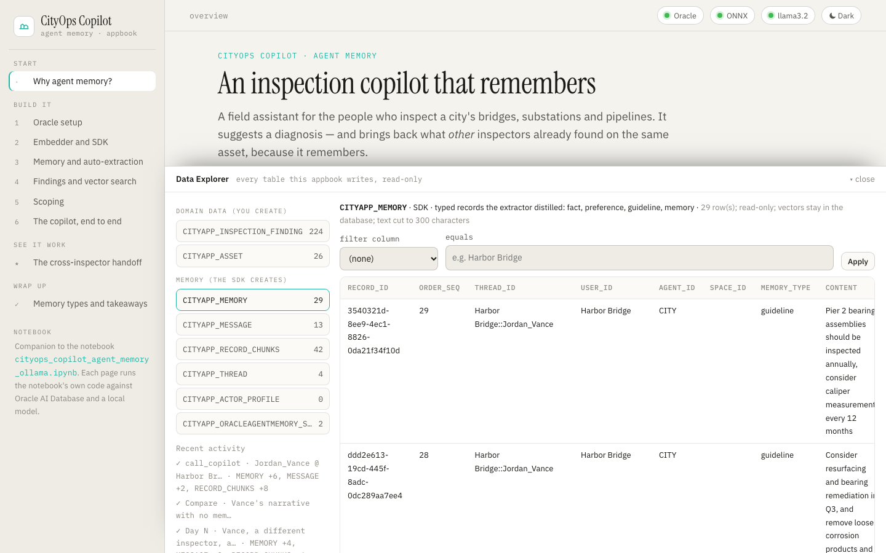

# CityOps Copilot · Appbook



An **appbook** is a working system you click through in the browser, wrapped in the narrative
that explains what you're looking at. This one is the interactive companion to the notebook
[`cityops_copilot_agent_memory_ollama.ipynb`](../../../notebooks/agent_memory/cityops_copilot/cityops_copilot_agent_memory_ollama.ipynb).
The notebook builds a field copilot for city infrastructure inspectors on Oracle AI Database and
Oracle AI Agent Memory (`oracleagentmemory`). The appbook explains the same ideas one page at a
time: what agent memory is, why the copilot needs it and how each piece works. It also runs the
notebook's own code live, with the same tables, SQL, SDK calls, system prompt and local model.

Each page leads with diagrams: layered architecture, flows and maps in one visual language
(amber = request and answer, salmon = the write path, blue = the read path). Captions are short,
the code is folded away, and a **Try it** panel runs that piece against Oracle and Ollama. Two
diagrams are live. The Part 6 turn map lights up step by step, with timings, as a copilot turn
runs. The handoff diagram fills in with what actually reached Vance. Anything that calls a model
runs as a job with numbered steps. Open a step to see its data, or an LLM call to read the exact
prompt and reply, including the prompts the SDK writes for itself (memory extraction,
context-card summaries). The **Data Explorer** at the bottom of every page shows every row the
app writes.



| Page                           | Notebook         | What it explains                                                                                                                                         | Try it                                                                                            |
| ------------------------------ | ---------------- | -------------------------------------------------------------------------------------------------------------------------------------------------------- | ------------------------------------------------------------------------------------------------- |
| Why agent memory?              | intro, Design    | the use case, the three gaps a stateless model leaves, what agent memory is and is not, domain data vs memory, the read-then-write loop, a glossary      | workspace status                                                                                  |
| 1 · Oracle setup               | Part 1           | one converged database for data and memory; the connection; which tables you create and which the SDK creates                                            | every table with row counts; reset the app's workspace                                            |
| 2 · Embedder and SDK           | Part 2           | embeddings and cosine distance; in-database ONNX (`VECTOR_EMBEDDING`); the `IEmbedder` bridge; every `OracleAgentMemory` argument; SDK LLM vs agent LLM  | embed sentences in Oracle and compare their distances                                             |
| 3 · Memory and auto-extraction | Part 3           | threads and verbatim messages (episodic memory); the extractor and its record types; the real extraction prompt; scope-matched search and `user_id=None` | the notebook's 4-narrative sample; `report_event` on any narrative; the memory log; scoped search |
| 4 · Findings and vector search | Part 4           | memory record vs domain object; `VECTOR(384)` and the HNSW index; similarity and filters in one SQL statement; `log_finding`                             | similar-finding search with filters; the TODO 5 checkpoint; log a finding; load all 222 findings  |
| 5 · Scoping                    | Part 5           | `user_id` / `agent_id` / `thread_id`; the asset as principal; private turns, shared knowledge; enforcement in SQL                                        | the notebook's leak test; a scope explorer                                                        |
| 6 · The copilot, end to end    | Part 6           | the eight steps of `call_copilot`; the context card; the asset-pooled search; the prompt; three model calls per turn                                     | a full copilot turn as any inspector on any asset, step by step                                   |
| The cross-inspector handoff    | Part 6 scenario  | Mercer's Day 1 → Vance's Day N, with no human handoff                                                                                                    | the five story steps; where Vance's context came from; with vs without memory                     |
| Memory types and takeaways     | closing sections | SDK record types → cognitive memory types; the wider memory landscape; what each layer earned                                                            | live counts per record type                                                                       |

## Run

```bash
cd apps/appbooks/cityops_copilot
python3 -m venv .venv && source .venv/bin/activate
pip install -r requirements.txt     # the notebook's pins (OAMP 26.4.0) plus FastAPI
./run.sh                            # → http://127.0.0.1:8730
```

The app reads the notebook's own `.env` in
[`notebooks/agent_memory/cityops_copilot/`](../../../notebooks/agent_memory/cityops_copilot)
(`DBUSER`, `DBPASSWORD`, `DB_DSN`, `OLLAMA_BASE_URL`; see its `.env.example`), so if the notebook
connects, so does the app. To give the app different settings, copy `.env.example` to `.env` in
this folder: it is read first, and environment variables win over both files.

`run.sh` uses `$PYTHON` if set, otherwise `python3`, and installs `requirements.txt` only when an
import check fails. `HOST` and `PORT` override the address.

## Requirements and failure behaviour

- **Oracle AI Database 26ai** (default `localhost:1522/FREEPDB1`) with a user that has the
  `ALL_MINILM_L12_V2` ONNX model loaded in its schema: the notebook's `prism` by default
  (`DBUSER`). The [notebook's README](../../../notebooks/agent_memory/cityops_copilot/README.md)
  shows how to set one up. The password comes from `DBPASSWORD` (or `PASSWORD`), the same
  variables the notebook reads. There is no fallback store.
- **Ollama** at `OLLAMA_BASE_URL` (default `http://localhost:11434`) with `llama3.2` pulled. It
  serves both the SDK's extractor and the copilot.
- **The data files** `maintenance_logs.json` and `inspection_reports.json`, read from the
  notebook's `data/` folder.

The app starts even when something is missing. The page loads, the status pills at the top show
what is wrong, the concept text reads normally, and each live panel says what it needs.
**Reconnect** retries after you fix it. Passwords are never sent to the browser.

## How it relates to the notebook's state

The app never touches the notebook's tables. Every table it creates or reads carries its own
prefix, `CITYAPP_` by default (`APPBOOK_TABLE_PREFIX`; the notebook's `CITY_` is refused):

| Notebook                                                                                                                       | App                                           | Created by                    |
| ------------------------------------------------------------------------------------------------------------------------------ | --------------------------------------------- | ----------------------------- |
| `CITY_ASSET`, `CITY_INSPECTION_FINDING`                                                                                        | `CITYAPP_ASSET`, `CITYAPP_INSPECTION_FINDING` | the code (Parts 3–4)          |
| `CITY_THREAD`, `CITY_MESSAGE`, `CITY_MEMORY`, `CITY_RECORD_CHUNKS`, `CITY_ACTOR_PROFILE`, `CITY_ORACLEAGENTMEMORY_SCHEMA_META` | the same names with `CITYAPP_`                | the SDK (`table_name_prefix`) |

On first start the app creates its tables, then loads the 26 assets and the first
`DEMO_FINDING_COUNT` (15) findings, as the notebook does. Data is kept across restarts. **Reset
the app's workspace** on the Part 1 page drops and rebuilds only the `CITYAPP_*` tables.

Differences from the notebook, all about running as a web app:

- **A connection pool:** a small pool replaces the notebook's single connection, so concurrent
  requests work and a database restart costs one reconnect. The embedder borrows a pooled
  connection for each call.
- **Prefixed constraint and index names:** the finding table's foreign key and HNSW index carry
  the prefix too, because constraint and index names are unique per schema.
- **Recorded SDK calls:** the SDK's LLM is wrapped (`TracingLlm`), so every internal call is
  recorded on the running job. The prompts you see are the ones the SDK sent.
- **Re-runnable scoping demo:** the Part 5 demo writes its two notes with fixed `memory_id`s, so
  it can run again without duplicating them.
- **Background jobs:** model-calling actions run as background jobs that the page polls
  (`GET api/jobs/{id}`), one at a time. A run keeps going when you leave the page, and the
  handoff story can run its five steps in order.

## Tests

From this folder, with the environment from **Run**:

```bash
python -m pytest tests/test_contracts.py -q    # offline: settings, prefix rules, every SQL statement prefixed,
                                               # the notebook's sample and asset rule, jobs, LLM capture,
                                               # explorer allowlist, routes, bounded bodies, relative URLs,
                                               # and that the notebook and the appbook link to each other
python tests/check_live.py                     # against a running server: every Part, the TODO checkpoints,
                                               # the scoping leak test and the whole handoff story (real
                                               # Oracle and Ollama; resets CITYAPP_* first; several minutes)
python tests/check_browser.py                  # Playwright: every page at desktop and phone width, the cheap
                                               # live panels, the Data Explorer, the theme
```

The live check treats the notebook's own assertions as hard checks. What the extractor decides to
keep varies from run to run: a small model sometimes files a fact as a preference, or a rule as a
fact. Those outcomes are reported as `NOTE` lines, not failures. Screenshots land in
`tests/artifacts/`, which git ignores. The browser check needs Chromium once:
`python -m playwright install chromium`.

## Architecture

```
apps/appbooks/cityops_copilot/
├── backend/
│   ├── main.py            FastAPI app; starts the runtime in the background; serves the page and the
│   │                      notebook's diagrams
│   ├── config.py          settings from the environment / .env (the notebook's defaults and folder)
│   ├── schemas.py         bounded request bodies
│   ├── core/
│   │   ├── lab.py         the notebook's code: embedder, SDK client, tables, report_event, log_finding,
│   │   │                  find_similar_findings, the scoping demo, call_copilot, the handoff story
│   │   ├── jobs.py        background jobs with a step log and captured LLM calls
│   │   ├── explorer.py    read-only, allowlisted table browsing (no SQL from the browser)
│   │   └── db.py          connection pool, query helpers, JSON-safe values
│   └── routers/           meta (health, reset, jobs) · parts (one group per Part + handoff) · data_explorer
├── frontend/              index.html · styles.css · app.js (shell, components, jobs, explorer)
│                          · figures.js (inline-SVG toolkit + every diagram, theme-aware; turn map and
│                            handoff update live) · pages_intro.js (overview, Parts 1–2)
│                          · pages_memory.js (Parts 3–5) · pages_copilot.js (Part 6, handoff, memory types)
│                          — no build step
└── tests/                 test_contracts.py · check_live.py · check_browser.py

notebooks/agent_memory/cityops_copilot/
├── cityops_copilot_agent_memory_ollama.ipynb    the notebook
├── data/                                        maintenance_logs.json · inspection_reports.json
└── diagrams/                                    the notebook's diagrams (SVG + Mermaid source)
```
