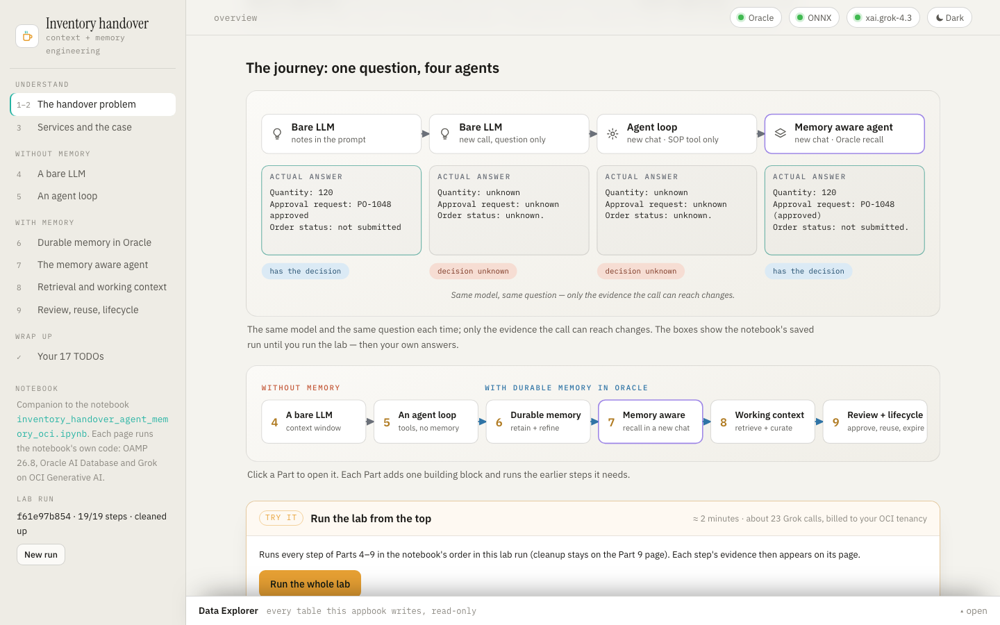
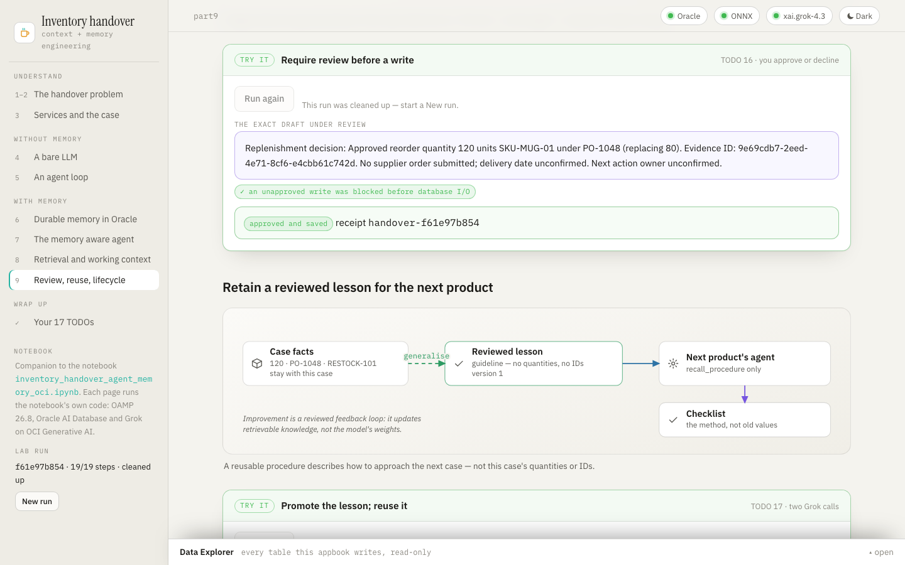

# Inventory Handover · Appbook



An **appbook** is a working system you click through in the browser, wrapped in the narrative
that explains what you're looking at. This one is the interactive companion to the notebook
[`inventory_handover_agent_memory_oci.ipynb`](../../../notebooks/agent_memory/inventory_handover/inventory_handover_agent_memory_oci.ipynb),
_Agent Memory: Introduction to context and memory engineering_. The notebook builds a memory
aware agent that helps the next inventory planner pick up an unfinished restocking decision.
Alice proposed 80 ceramic mugs, the manager approved 120 under PO-1048, and no supplier order
has been submitted.

The appbook tells the same story page by page, diagram-first: layered architecture, flows and
maps in one visual language (amber = request and answer, salmon = the write path, blue = the read
path, violet = model calls). It runs the notebook's own code live, with the same prompts,
policies, tools, OAMP 26.8 calls and checks, against Oracle AI Database and Grok on OCI
Generative AI.

Every model call is shown with its exact prompt and reply. That covers the agent's calls
(through a LangChain callback) and OAMP's own: memory extraction, link extraction, thread
summaries, pruning decisions and the handover draft. Every job also counts the OAMP operation
events it caused, and the **Data Explorer** at the bottom of every page shows each row the app
writes.



| Page                          | Notebook  | Diagrams                                                                                                                                          | Try it                                                                 |
| ----------------------------- | --------- | ------------------------------------------------------------------------------------------------------------------------------------------------- | ---------------------------------------------------------------------- |
| The handover problem          | Parts 1–2 | the mug story · the layered architecture · four memory roles · context vs memory engineering · the four-stage journey (fills in live) · Parts 4–9 | run the whole lab                                                      |
| Services and the case         | Part 3    | two clients, one hosted model                                                                                                                     | structured-output + embedding checks (TODO 3)                          |
| A bare LLM                    | Part 4    | the context gap (redraws with your answers)                                                                                                       | TODO 1                                                                 |
| An agent loop                 | Part 5    | choose → execute → observe → repeat                                                                                                               | TODO 2                                                                 |
| Durable memory in Oracle      | Part 6    | the memory lifecycle · users, threads, shared procedures · supersede without erasing                                                              | procedures · TODO 4 · TODO 5 (with the links OAMP inferred) · TODO 6–7 |
| The memory aware agent        | Part 7    | offload and compaction (sized from your run) · memory tools on the same loop · the journey                                                        | TODO 8–9 · TODO 10–11 · the fresh session · the four-way comparison    |
| Retrieval and working context | Part 8    | retrieve → inspect → prune · operation events · assembling the context                                                                            | 8.1 · TODO 12 · TODO 13 · TODO 14                                      |
| Review, reuse, lifecycle      | Part 9    | the review gate · reusing a lesson · expiry vs erasure                                                                                            | TODO 15 · TODO 16 (**you approve or decline**) · TODO 17 · 9.4 · 9.5   |
| Your 17 TODOs                 | 9.6       | the TODO map                                                                                                                                      | —                                                                      |

Pages build on each other the way the notebook does. One **lab run** (a `RUN_ID`, like a fresh
kernel) holds the state, and each step first runs any earlier step it needs. **Run the whole
lab** on the first page does Parts 4–9 in order (about 2 minutes, ~23 Grok calls). **New run**
in the sidebar starts again.

## Run

```bash
cd apps/appbooks/inventory_handover
python3 -m venv .venv && source .venv/bin/activate
pip install -r requirements.txt     # OAMP 26.8.0 and the notebook's pins, plus FastAPI
./run.sh                            # → http://127.0.0.1:8735
```

The app reads the notebook's own `.env` in
[`notebooks/agent_memory/inventory_handover/`](../../../notebooks/agent_memory/inventory_handover)
(`DBPASSWORD`, `DB_DSN`, `OCI_GENAI_API_KEY`, `ENDPOINT`, `OCI_GENAI_MODEL`, …; see its
`.env.example`), so if the notebook runs, so does the app. To give the app different settings,
copy `.env.example` to `.env` in this folder: it is read first, and environment variables win
over both.

`requirements.txt` includes the notebook's own pins, so the app and the notebook run the same
OAMP. If the notebook's first cell has already installed them into its `.packages` overlay, the
backend puts that overlay first, as the notebook does. `run.sh` uses `$PYTHON` if set,
otherwise `python3`, and installs `requirements.txt` only when an import or version check
fails. `HOST` and `PORT` override the address.

## Requirements and failure behaviour

- **Oracle AI Database 26ai** (default `localhost:1522/FREEPDB1`) with the `prism` user and the
  `ALL_MINILM_L12_V2` ONNX model. The
  [notebook's README](../../../notebooks/agent_memory/inventory_handover/README.md) shows how to
  set one up.
- **OCI Generative AI:** either an API key (`OCI_GENAI_API_KEY`), or OCI config-file signing
  with `COMPARTMENT_OCID`. An API key is valid only in the region it was created in, so set
  `ENDPOINT` to that region. The model is `xai.grok-4.3` by default, and requests are billed to
  the tenancy.
- **OAMP 26.8.0**, from `requirements.txt`.

The page loads even when something is missing. The status pills show what is wrong, the
explanations read normally, and **Reconnect** retries after a fix. Keys and passwords never
reach the browser.

## How it relates to the notebook's state

The app keeps its own OAMP store, `INVAPP` (`APPBOOK_STORE`; the notebook's `ZH_INVENTORY` is
refused), so it never touches the notebook's tables. Within that store, every record carries the
lab run's ID, exactly as the notebook scopes its data. Part 9.5's cleanup deletes only that run's
two case threads, and the shared procedures keep their 30-day TTL.

Differences from the notebook, all about running as a web app:

- **A subclass, not a wrapper:** OAMP's `Llm` is subclassed (`TracingLlm`) to record its calls.
  In OAMP 26.8, a wrapper object makes background extraction fail.
- **The review gate is real:** Part 9.2's review gate asks _you_. The page shows the exact draft
  and its `APPROVE <digest>` phrase, and the host saves only on an exact match. The notebook's
  unattended run declines.
- **Jobs, not cell outputs:** steps run as background jobs that the page polls, one at a time.

## Tests

From this folder, with the environment from **Run**:

```bash
python -m pytest tests/test_contracts.py -q   # offline: settings and store rule, the step graph, the Llm subclass,
                                              # OAMP call labels, explorer allowlist, routes, renderers, relative URLs,
                                              # and that the notebook and the appbook link to each other
python tests/check_live.py                    # against a running server: a new run, the whole lab with the notebook's
                                              # checks, approval (wrong phrase refused, exact phrase saved), cleanup
python tests/check_browser.py                 # Playwright: every page at desktop and phone width, one live step,
                                              # Data Explorer, theme, status, a new run
```

The live check makes about 25 Grok calls. What the model chooses to say is reported as `NOTE`
lines; the notebook's own assertions are hard checks. Screenshots land in `tests/artifacts/`,
which git ignores. The browser check needs Chromium once: `python -m playwright install chromium`.

## Architecture

```
apps/appbooks/inventory_handover/
├── backend/
│   ├── __init__.py        puts the notebook's .packages overlay first when it exists, as the notebook does
│   ├── main.py            FastAPI app; starts the runtime in the background; serves the page and the
│   │                      notebook's diagrams
│   ├── config.py          settings from the environment / .env (the notebook's defaults and folder)
│   ├── core/
│   │   ├── lab.py         the notebook's code: every step (Parts 4–9) with its prerequisites, the lab run,
│   │   │                  TracingLlm (OAMP's calls) and the agent callback (Grok calls)
│   │   ├── jobs.py        background jobs: step log, LLM calls, OAMP event counts, row deltas
│   │   ├── explorer.py    read-only, allowlisted browsing of the INVAPP_* tables (no SQL from the browser)
│   │   └── db.py          connection pool, query helpers, JSON-safe values
│   └── routers/api.py     health · state · new run · one job per step · run-all · approve · explorer
├── frontend/              index.html · styles.css · app.js (shell, jobs, step panels, explorer)
│                          · figures.js (SVG toolkit) · diagrams.js (every diagram; several take live results)
│                          · pages_intro.js (overview, Part 3) · pages_without.js (Parts 4–5)
│                          · pages_memory.js (Parts 6–7) · pages_context.js (Parts 8–9, TODO map)
└── tests/                 test_contracts.py · check_live.py · check_browser.py

notebooks/agent_memory/inventory_handover/
├── inventory_handover_agent_memory_oci.ipynb    the notebook
├── inventory_data.json                          the case
├── requirements.txt                             OAMP 26.8.0 and the lab's pins
└── diagrams/                                    the notebook's diagrams (SVG)
```
